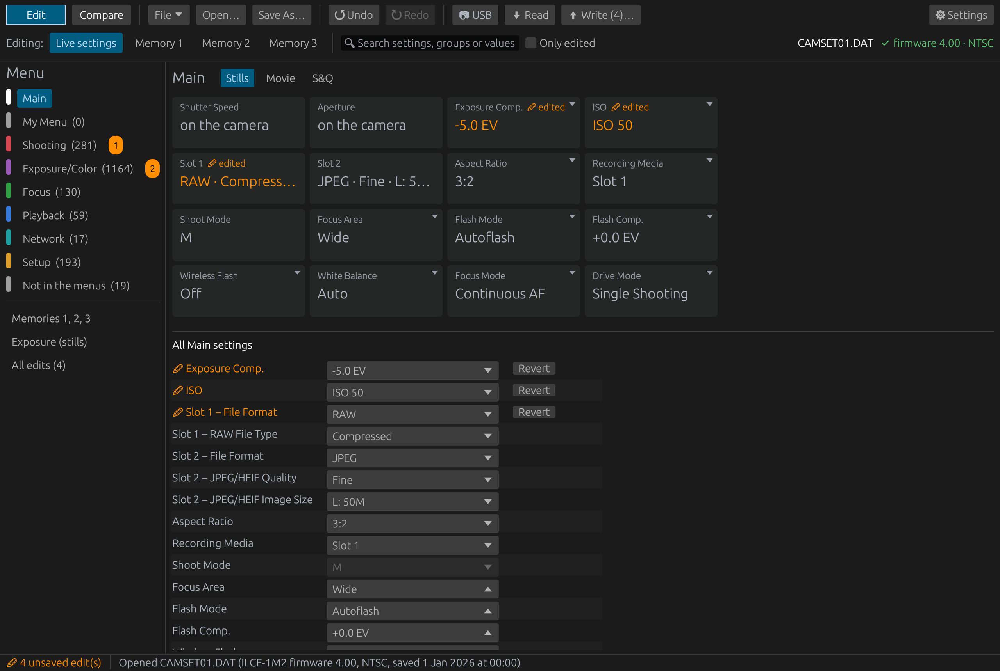
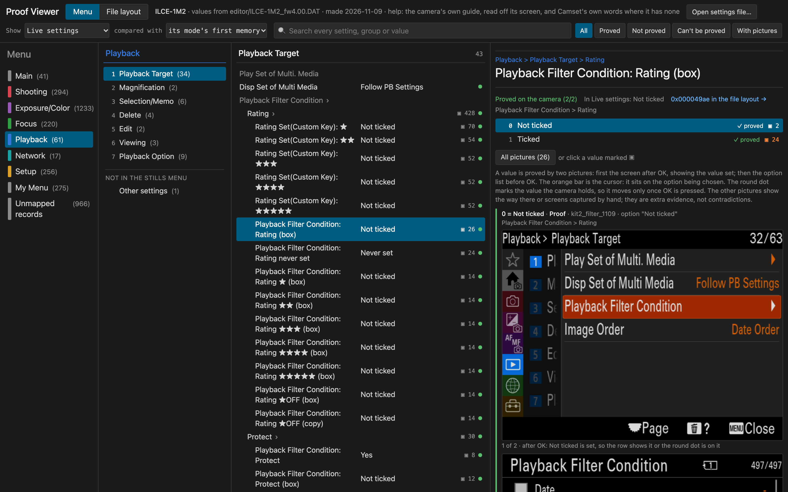
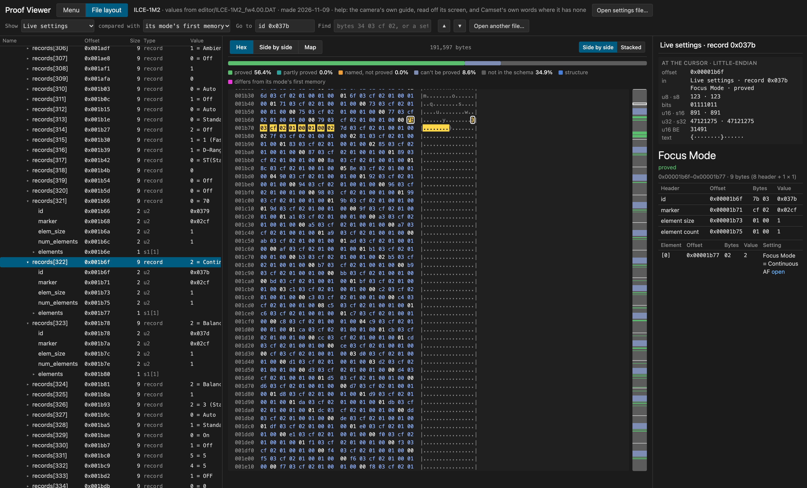

# Camset

[](https://github.com/camset-dev/camset/releases) [](https://github.com/camset-dev/camset/releases) [](https://github.com/camset-dev/camset/actions/workflows/editor-ci.yml)

Camset reads, compares and edits Sony camera settings files (`CAMSET*.DAT`), the files a camera saves to its card
with MENU > Setup > Reset/Save Settings > Save/Load Settings. It has two parts: the Camset Editor, an app for anyone
with a camera it knows, and a mapping kit that works out, on the camera itself, what each setting in a new camera's
file means.



To look inside a settings file with nothing to install, open the
[definition viewer](https://camset-dev.github.io/camset/viewer/) and choose the file: it shows every setting by name
for each camera Camset knows, and the file never leaves your computer. Each release also carries it as one file that
opens with no internet,
[camset-viewer.html](https://github.com/camset-dev/camset/releases/latest/download/camset-viewer.html).

## Use the editor

Take the latest release from the [Releases page](https://github.com/camset-dev/camset/releases):

- **macOS** (Apple silicon): open the `.dmg` and drag Camset Editor onto Applications. The app is not notarized, so
  macOS refuses it the first time: open System Settings > Privacy & Security and click Open Anyway (on macOS 14 and
  earlier, right-click the app > Open).
- **Linux:** unpack the tarball and run `sh install.sh` in its folder. It installs for you alone, with no root, and
  adds a menu entry.
- **Windows** (10 or 11, 64-bit, Intel or AMD): the installer, `camset-editor-<version>-windows-x64-setup.exe` (from
  0.3.0), installs for you alone with no administrator rights; a newer installer updates it in
  place, and Settings > Apps uninstalls it. The zip, `camset-editor-<version>-windows-x64.zip`, installs nothing:
  unpack it and run `camset_editor.exe`, keeping the folder's files together. Neither touches
  [your own files](docs/EDITOR.md#what-the-editor-keeps-on-this-computer). Neither is signed yet
  ([code signing policy](https://camset-dev.github.io/camset/CODE_SIGNING_POLICY/)), so SmartScreen warns the first
  time ("Windows protected your PC"): click More info, then Run anyway. Smart App Control, where it is on, blocks
  them outright.

To change your camera's settings, save them on the camera (Save/Load Settings > Save writes a file into the card's
`PRIVATE/SONY/CAMSET` folder), open that file, edit it, Save As…, copy the new file into the same folder and choose it
with Save/Load Settings > Load. Read the [warning](#warning) first. Without a camera, Explore a sample.
[From the card and back](docs/EDITOR.md#from-the-card-and-back) has the details and what is not yet tried, and
[docs/EDITOR.md](docs/EDITOR.md) is the whole guide. Reading and writing the camera directly needs the
[camera helper](#the-camera-helper).

### Check a download

From 0.3.0, each release holds `SHA256SUMS`, the SHA-256 checksum of every package and of the
viewer. Download it into the folder with your file, and in a terminal there:

- **macOS:** `shasum -a 256 -c --ignore-missing SHA256SUMS`
- **Linux:** `sha256sum -c --ignore-missing SHA256SUMS`

  Each prints your file's name and OK; anything else means the file is not the one released: download it again.
- **Windows,** in PowerShell, with your file's name in the first quotes (it prints True when the checksum matches):

  ```powershell
  $f = "camset-editor-<version>-windows-x64-setup.exe"; (Get-FileHash $f -Algorithm SHA256).Hash -eq ((Get-Content SHA256SUMS | Where-Object { $_.EndsWith("  $f") }) -split ' ')[0]
  ```

The checksums show that the file arrived whole, not who built it. GitHub's build provenance does: with
[gh](https://cli.github.com/), signed in with `gh auth login`,

```sh
gh attestation verify <file> --repo camset-dev/camset --signer-workflow camset-dev/camset/.github/workflows/editor-release.yml
```

checks that the project's release workflow built the file from this repository and names the commit; add
`--source-ref refs/tags/v<version>` to require a given release. Neither check is a code signature.

## Warning

<!-- --8<-- [start:warning] -->
**Writing an edited settings file to a camera is at your own risk.** A file edited by hand once put a camera
into a restart loop in Movie mode, which ended when Initialize was run on the camera; Initialize also clears
the network setup and the memories. The editor and the camera may refuse or change values. Always keep the camera's
own backup, a settings file it saved itself, to load back: on the card and on your computer.

This is an independent project, not affiliated with or endorsed by Sony. Sony and the camera names are used
only to say what the files are.
<!-- --8<-- [end:warning] -->

What to do if it happens: [If the camera restarts over and over](docs/EDITOR.md#if-the-camera-restarts-over-and-over).

## Map your camera

If the editor does not know your camera yet, you can map it yourself with an AI agent that works in a terminal, such
as Claude Code, Codex or Gemini CLI. You need a Sony camera that Sony's Camera Remote SDK can drive, the SDK (free from
Sony, by application: [The camera helper](#the-camera-helper)), a Mac, Linux PC or Windows 11 PC with a USB-C data
cable, and a vision-language model to read the camera's screen
([what you need](docs/QUICKSTART.md#what-you-need), [how to choose the model](docs/QUICKSTART.md#choosing-a-reader)).

Clone this repository, start the agent in it and say: "read AGENTS.md and map my camera". It guides you and asks for
what only a person can do, such as turning a dial. At the end the kit writes your camera's definition,
`editor/definitions/<model>_fw<fw>.json`, which the editor takes the same day (Settings > Camera support & web page >
Add definition…). Send it back as a pull request ([CONTRIBUTING](CONTRIBUTING.md)) and the next release ships it.

Every value the kit proves is kept with the camera's screens that proved it: `kit/tools/proof_viewer.py --open` shows
them in the definition viewer's page, on the computer where the kit ran. Below, the a1 II's sample in it:





## Develop

The kit needs Python 3.11 to 3.14, the editor stable Rust (rustup.rs). With Sony's SDK zip in `kit/sdk/`,
`python3 kit/setup.py` sets everything up ([QUICKSTART](docs/QUICKSTART.md), step 1). Without the SDK, for the editor
and the docs:

```sh
python3.11 -m venv .venv && .venv/bin/pip install -r kit/requirements.txt   # or python3.12 to python3.14
.venv/bin/python -m pytest -q kit/tests          # the kit's tests (about four in ten skip without camera runs)
(cd editor && cargo test --release)              # the editor's tests
(cd editor && cargo run --release)               # the editor from source
.venv/bin/pre-commit install                     # once: the hooks that rebuild generated files and check the data and docs
.venv/bin/pre-commit run --all-files             # the same hooks by hand
.venv/bin/zensical serve                         # the docs site at http://127.0.0.1:8000
```

On Linux the editor needs the windowing libraries first:
`sudo apt-get install libxkbcommon-dev libxcb-render0-dev libxcb-shape0-dev libxcb-xfixes0-dev libwayland-dev`.
The web page's tests need `node`. From `editor/`, `sh packaging/build_macos_app.sh` builds the macOS app and `.dmg`
and `sh packaging/build_linux.sh` the tarball, into `editor/target/dist/`
([how a release is built](docs/RELEASING.md#installers)). Windows and Linux: [docs/PORTING.md](docs/PORTING.md). Each
fact is edited in one place ([decision 14](docs/decisions/0014-one-source-per-fact.md)).

## What the editor does

- Shows every setting in a file by name, under the camera's own tabs, with what it does and the shooting modes it
  applies in; the memories (1, 2, 3) beside the live settings; aperture, shutter speed and ISO on aligned stop scales.
- Compares files A, B and an optional base, steps through the differences, copies them across or merges B into A.
- Edits and saves whole files only, and keeps a copy of every file as first opened.
- Reads and writes the camera over USB or the network, with the camera helper.
- Serves a web page, off until you turn it on, that does what the window does from a phone, a tablet or another
  computer.

## The camera helper

The editor needs no Sony software to open, edit and save files. Reading and writing a camera goes through the camera
helper, `camset_probe` (`kit/probe/`), which you build yourself from Sony's Camera Remote SDK: download the SDK from
Sony's [Camera Remote SDK page](https://support.d-imaging.sony.co.jp/app/sdk/l/index.php) (free, by application; you
accept its agreement), put the zip into `kit/sdk/` and run `python3 kit/setup.py`. An editor run from the clone finds
the helper; any other asks for it with "Choose the program…" in Connect to the camera. The SDK is never in this
repository and the editor's packages do not carry the helper ([Sony's terms](docs/RELEASING.md#sony-camera-remote-sdk-terms)).
Using a camera through an app built with the SDK can put it outside Sony's warranty, except in the countries the
agreement lists.

## Supported cameras

- **ILCE-1M2 (a1 II), firmware 4.00:** verified; its definition comes with the editor. Records not mapped or not yet
  verified show only in Expert mode (Settings > Editing & Compare > Expert mode).
- **A camera you mapped with the kit:** its definition works the same day through Add definition…; sent back, it
  ships with the next release.
- **Another firmware of a known model** opens with the nearest firmware's definition and can be edited after a
  warning; settings it does not hold in the mapped shape stay view only. **A model no definition covers** opens view
  only.

## Repository layout

| Folder | What it holds |
|---|---|
| `editor/` | The Rust/egui app. `definitions/` holds the camera definitions it ships with, one per model and firmware, each with its sample (`<model>_fw<fw>.json` and `.DAT`); the editor holds no camera facts of its own ([decision 20](docs/decisions/0020-the-editor-holds-no-camera-facts.md)). |
| `kit/` | The mapping kit: the pipeline's commands (page scan, crawl, pass 1's map, proofs, report, definition), their library `camkit/`, the provers for special screens in `provers/`, the checks and doc builders in `tools/`, and the camera link (`link/`) and camera helper (`probe/`), C++ on Sony's SDK in `kit/sdk/`. |
| `data/` | What has been learned, one folder per camera and firmware ([what a mapping delivers](docs/DATA_CONTRACTS.md#what-a-mapping-delivers)). |
| `docs/` | The docs site (Zensical, `mkdocs.yml`), the file format (`docs/formats/`) and the decisions (`docs/decisions/`). |
| `schemas/` | JSON Schemas of the definitions and the data files. |
| `private/` | Your own folder, git-ignored: your config, your camera's files, the help text read off it ([decision 18](docs/decisions/0018-one-public-codebase-with-a-private-overlay.md)). |
| `runs/` | Local only: each camera's runs, downloads and proof viewer, in `runs/<model>_fw<fw>/` ([Where the runs go](docs/QUICKSTART.md#where-the-runs-go)). |

## Licence

MIT ([LICENSE](LICENSE)). The editor's packages carry the licences of the Rust crates and fonts built into the program
as `THIRD_PARTY_LICENSES.html` (`cargo about`, from `editor/about.toml`).
