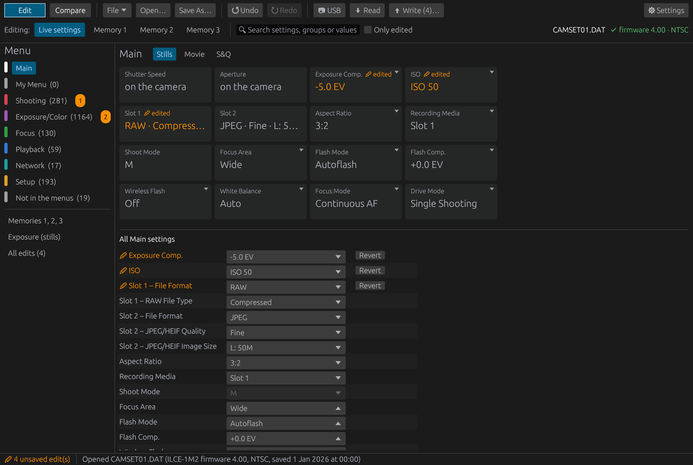
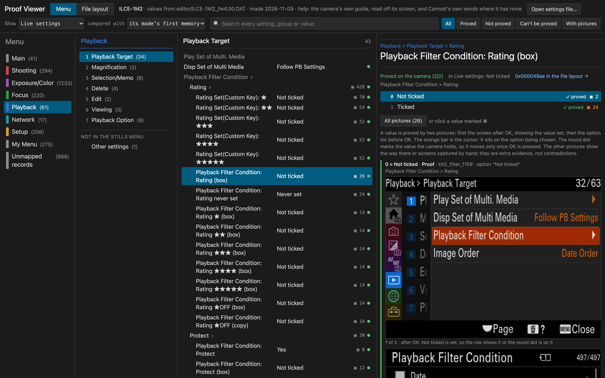
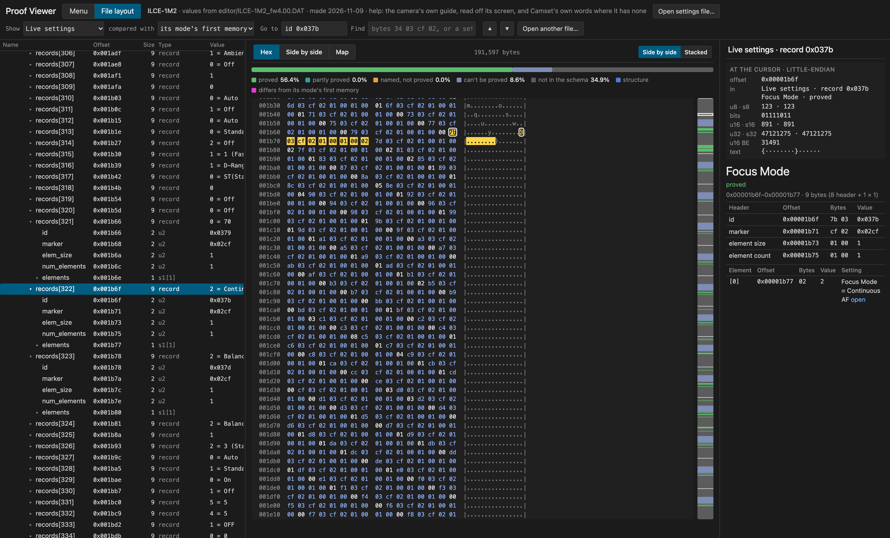

# Camset

[](https://github.com/camset-dev/camset/releases) [](https://github.com/camset-dev/camset/releases) [](https://github.com/camset-dev/camset/actions/workflows/editor-ci.yml)

Camset reads, compares and edits Sony camera settings files (`CAMSET*.DAT`), the files a camera saves to its card
with MENU > Setup > Reset/Save Settings > Save/Load Settings. It has two parts: the Camset Editor, an app for anyone
with a camera it knows, and a mapping kit that works out, on the camera itself, what each setting in a new camera's
file means.



To look inside a settings file with nothing to install, open the
[definition viewer](https://camset-dev.github.io/camset/viewer/) and choose the file: it shows every setting by name
for each camera Camset knows ([more below](#the-definition-viewer-and-the-proof-viewer)).

## Use the editor

The editor is on the project's [Releases page](https://github.com/camset-dev/camset/releases): the app in a `.dmg`
for macOS on Apple silicon, a tarball for Linux and, since 0.2.1, a zip for Windows, with an installer beside it from
the release after 0.2.1; it also builds from source on each of them
([The editor from source](#the-editor-from-source)). Take the latest release: 0.1.0 is withdrawn (its editor does not
open today's camera definitions), and 0.2.0 has no Windows zip.

- **macOS:** open the disk image and drag Camset Editor onto Applications. The app is not notarized, so macOS
  refuses to open it the first time. Then open System Settings > Privacy & Security and click Open Anyway (on macOS
  14 and earlier, right-click the app > Open instead). Not yet tried on a downloaded copy.
- **Windows** (64-bit Windows 10 or 11, on Intel or AMD): from the release after 0.2.1, two downloads hold the same
  program (0.2.1 has the zip only). Take the installer unless you would rather install nothing.
  - The installer, `camset-editor-<version>-windows-x64-setup.exe`, needs no administrator rights: it installs the
    editor for you alone (in `%LOCALAPPDATA%\Programs\Camset Editor`), puts it in the Start menu (and on the desktop,
    if you tick that) and in Windows' installed apps (Settings > Apps), where you uninstall it. To update, run a newer
    installer: it replaces the older version in place. Neither updating nor uninstalling touches your own files: your
    preferences, the definitions you added and the copies the editor keeps stay in the editor's own folder
    (`%APPDATA%\camset_editor`, or under `XDG_CONFIG_HOME` if you have set that;
    [what it keeps](docs/EDITOR.md#what-the-editor-keeps-on-this-computer)).
  - The zip, `camset-editor-<version>-windows-x64.zip`, installs nothing: unpack it anywhere and run
    `camset_editor.exe` in the folder it makes; keep that folder's files together, as the editor reads its camera
    definitions from beside it. To update, unpack the newer zip and delete the old folder (your own files are not in
    it).

  Neither is signed yet, so Windows SmartScreen warns the first time you open the downloaded installer or program
  ("Windows protected your PC"): click More info, then Run anyway. Where Windows 11's Smart App Control is on, it
  blocks an unsigned program outright, with no Run anyway. Both will be so until the project arranges code signing.
  The camera helper is in neither, as in the other packages ([The camera helper](#the-camera-helper)). The editor was
  built and used on a Windows 11 PC; the downloaded zip and installer not yet tried.

**Code signing policy:** the Windows downloads are not signed yet; the
[code signing policy](https://camset-dev.github.io/camset/CODE_SIGNING_POLICY/) says what will be signed, and by
whom, once the project's application for free code signing is accepted.

Then open a settings file from your camera's card, or the built-in sample to look around without a camera. The
downloaded editor works with the files on the card:

1. On the camera, MENU > Setup > Reset/Save Settings > Save/Load Settings > Save writes the file into the card's
   `PRIVATE/SONY/CAMSET` folder.
2. Open it in the editor, edit it, Save As…, and copy the new file into that folder (the a1 II lists at most 10 settings files there).
3. On the camera, Save/Load Settings > Load, and choose the file.

[From the card and back](docs/EDITOR.md#from-the-card-and-back) has the details and what has not been tried yet.
Reading and writing the camera directly, without the card, needs the camera helper, which you build yourself
([The camera helper](#the-camera-helper)). Read the warning below before you load or write an edited file.
[What the editor does](#what-the-editor-does) is further down; the whole guide is [docs/EDITOR.md](docs/EDITOR.md).
Which version you have is at the right end of the status bar; a click on it opens ⚙ Settings > About, with the
build, Changes (what changed, release by release) and Third-party licences. The web page has the same.

## Warning

<!-- --8<-- [start:warning] -->
**Writing an edited settings file to a camera is at your own risk.** A file edited by hand once put a camera
into a restart loop in Movie mode, which ended when Initialize was run on the camera; Initialize also clears
the network setup and the memories. The editor and the camera may refuse or change values. Always keep the camera's
own backup, a settings file it saved itself, to load back: on the card and on your computer.

This is an independent project, not affiliated with or endorsed by Sony. Sony and the camera names are used
only to say what the files are.
<!-- --8<-- [end:warning] -->

What to do if it happens: [If the camera restarts over and over](docs/EDITOR.md#if-the-camera-restarts-over-and-over).

## Map your camera

If the editor does not know your camera yet, you can map it yourself with an AI agent. You need:
- a Sony camera that Sony's Camera Remote SDK can drive (the agent checks yours first);
- the SDK, which you download from Sony yourself and drop into `kit/sdk/` for `python3 kit/setup.py` to set up
  ([The camera helper](#the-camera-helper) says where);
- a Mac; or a Linux PC (the setup, the tests and the editor's camera helper checked on Ubuntu 26.04, the kit's camera
  runs not yet); or a Windows 11 PC on Intel or AMD (the setup, the tests and the editor's camera helper tried, the
  kit's camera runs not yet); and a USB-C data cable to the camera;
- an AI agent that works in a terminal, such as Claude Code, Codex or Gemini CLI;
- a vision-language model (VLM) to read the camera's screen, since OCR alone misreads icons and short words: one on
  your own computer or server if it can run one (this project used Qwen3.8 27B), a smaller local model if not, or a
  paid service that offers one ([how to choose](docs/QUICKSTART.md#choosing-a-reader)).

Clone this repository, start the agent in it and say: "read AGENTS.md and map my camera". It guides you and asks for
what only a person can do, such as turning a dial. At the end the kit writes your camera's own definition,
`editor/definitions/<model>_fw<fw>.json`, and the editor uses it the same day, with no new editor: Settings > Camera
support & web page > Add definition… ([decision 19](docs/decisions/0019-definitions-are-files-one-per-model-and-firmware.md)).
Then send the result back as a pull request, so the next release ships it.

### The definition viewer and the proof viewer

The **definition viewer**, at <https://camset-dev.github.io/camset/viewer/>, is for anyone: open it in a browser,
press Open your settings file… and choose a `CAMSET*.DAT`. It finds the file's camera among the definitions Camset
has and shows every setting by name, in the camera's menu as the editor lays it out (its Expert switch shows every
setting the definition holds), with whether a proof on the camera checked each value, and the file's layout byte by
byte. Nothing is installed, and the file is read in your browser and never leaves your computer. Until a file is open
it shows the camera's sample, not your camera: a file one camera of that model wrote right after Initialize, its
personal text removed, in which some values are what that camera held, as Initialize does not reset every record. A
file of another firmware is read with the nearest one's definition, and the page says so. A file of a camera with no
definition yet opens too, its structure only and nothing named, when it is laid out like the files of a camera the
viewer knows; any other file is refused. The page on the docs site then shows the refused file's size and first 256
bytes as a hex dump, to paste into a report of the problem once you have checked it holds nothing of yours (the
downloadable file has this from the release after 0.2.1). Besides the page on the docs site, each release from 0.2.1
carries the viewer as one file, `camset-viewer.html`, to download and open with no internet; the latest is always at
<https://github.com/camset-dev/camset/releases/latest/download/camset-viewer.html>. It is built from the public
definitions alone, with `kit/tools/proof_viewer.py --public --out site/viewer`, or as that one file with
`kit/tools/proof_viewer.py --public --single --out site/camset-viewer.html`.

The **proof viewer** is the same page with the camera's own screens: every value the kit proves is kept with the
screens that proved it, and `kit/tools/proof_viewer.py --open` lays them out as a local page
([QUICKSTART](docs/QUICKSTART.md#command-cheat-sheet)). It exists only where the kit has run, since it shows that
camera's own pictures. The Menu view is the camera's menu as the definition places it: the tabs, each group's rows
with the value the open file holds, and for the chosen row every value with its proof and the pictures behind it. The
File layout view is the file itself: the container's structure as the definition names it, the bytes with the chosen
record lit, how much of the file is proved, and what each record decodes to. The pictures below show the a1 II's
sample file.





## Develop

The kit needs Python 3.11 to 3.14 ([PORTING](docs/PORTING.md) says why not 3.15 yet), and the editor Rust (stable,
from rustup.rs; the crate uses the 2024 edition). With Sony's SDK zip in `kit/sdk/`, `python3 kit/setup.py` makes
`.venv` with the newest of those Pythons, installs the hooks, builds the camera link and the camera helper and runs the
kit's tests ([QUICKSTART](docs/QUICKSTART.md), step 1). Without the SDK (for the editor and the docs), by hand:

```sh
python3.11 -m venv .venv && .venv/bin/pip install -r kit/requirements.txt   # or python3.12 to python3.14
.venv/bin/python -m pytest -q kit/tests          # the kit's tests
(cd editor && cargo test --release)              # the editor's tests
.venv/bin/pre-commit install                     # once: the hooks that rebuild generated files and check the data and docs
.venv/bin/pre-commit run --all-files             # the same hooks by hand
.venv/bin/zensical serve                         # the docs site at http://127.0.0.1:8000
```

About four in ten of the kit's tests skip without camera runs in `runs/` (the local folder of camera runs); that is expected. The web page's script, `editor/web/app.js`, is tested among them: `kit/tests/test_page_script.py` loads it whole under `node` in the small made-up DOM of `kit/tests/page_harness.js` (no npm package) and checks its own functions on made-up rows; those tests skip where `node` is missing. Each fact is edited in one place
([decision 14](docs/decisions/0014-one-source-per-fact.md)); the docs site's page [Where each fact lives](docs/WHERE_FACTS_LIVE.md)
says where each one lives. Camera runs and the command cheat sheet are in [docs/QUICKSTART.md](docs/QUICKSTART.md),
Windows and Linux in [docs/PORTING.md](docs/PORTING.md). Rebuilding the reader a test generates from the format's
Kaitai description needs `kaitai-struct-compiler` 0.11 (`brew install kaitai-struct-compiler`; it runs on Java). [docs/RELEASING.md](docs/RELEASING.md) holds the SDK's
terms and how a release is made.

## What the editor does

- Shows every setting in a file by name, by the camera's own tabs, with what each one does and which shooting
  modes it applies in. The memories (1, 2, 3) sit beside the live settings; the Exposure page puts aperture,
  shutter speed and ISO on aligned stop scales.
- Compares files: any sections of file A, file B and an optional base file, with the differences stepped
  through, copied across, or merged from B into A.
- Edits and saves whole files only, and keeps a copy of every file as first opened, so you can go back.
- Reads from and writes to the camera over USB or the network, with the camera helper, which you build yourself
  (below); the downloaded editor does not include it, and works with files from the card.
- Serves a small web page, off until turned on, that does what the window does from a browser on a tablet, a phone
  or another computer: the same pages, windows and settings, Compare, Memories and Exposure included. The camera's
  login, and the settings that belong to the editor's own computer, stay in the desktop app.
- Opens a built-in sample, a file with personal text removed, to explore without a camera.

## The camera helper

The editor needs no Sony software to open, edit and save files. Reading from and writing to a camera goes
through the camera helper, `camset_probe` (`kit/probe/`, C++), which you build yourself against your own copy
of Sony's Camera Remote SDK: download the SDK from Sony's
[Camera Remote SDK page](https://support.d-imaging.sony.co.jp/app/sdk/l/index.php) (free, by application to Sony; you
accept its agreement when downloading), put the zip for your system into `kit/sdk/` and run `python3 kit/setup.py`,
which unpacks it and builds the helper with the rest of the kit. An editor run from the clone finds it in
`kit/probe/build/`; any other, choose it with "Choose the program…" on the first card of Connect to the camera,
which shows while the program is not found (later, Settings > Camera link > Camera link program, in Expert mode).
The SDK is not in this repository and never will be, and the editor's packages do not include the helper.

Apps built with the SDK may be distributed, but the SDK itself (its libraries, headers, samples and documents) may
not be shared; the terms are summarised in [docs/RELEASING.md](docs/RELEASING.md). Using a camera through such an
app can put it outside Sony's warranty, except in the countries the agreement lists.

## The editor from source

```sh
cd editor && cargo run --release
```

On Linux the windowing libraries are needed first:
`sudo apt-get install libxkbcommon-dev libxcb-render0-dev libxcb-shape0-dev libxcb-xfixes0-dev libwayland-dev`.
The packages themselves: `sh packaging/build_macos_app.sh` builds `Camset Editor.app` and a `.dmg`, and
`sh packaging/build_linux.sh` a tarball, both run from `editor/` and both into `editor/target/dist/`. For a release,
`.github/workflows/editor-release.yml` builds them on a version tag, and on Windows the zip and the installer
(Inno Setup, `packaging/windows/installer.iss`) ([RELEASING](docs/RELEASING.md#installers)).

## Supported cameras

- **ILCE-1M2 (a1 II), firmware 4.00:** verified; its definition comes with the editor. Records not mapped yet,
  and values not yet verified, show only in Expert mode (Settings > Editing & Compare > Expert mode).
- **A camera you mapped with the kit:** its definition, `editor/definitions/<model>_fw<fw>.json`, works in the editor
  the same day through Settings > Camera support & web page > Add definition…, with no new editor; sent back, it
  ships with the next release.
- **Any other model or firmware:** a file from the same model on another firmware opens with the nearest
  firmware's definition and can be edited after a warning; settings it does not hold in the mapped shape stay
  view-only. A model no definition covers opens view-only.
- **Mapping another camera:** [docs/REMAPPING_PLAYBOOK.md](docs/REMAPPING_PLAYBOOK.md). How to check whether
  the mapping kit can drive a body through the SDK: [docs/CAMERA_SUPPORT.md](docs/CAMERA_SUPPORT.md).

## Repository layout

| Folder | What it holds |
|---|---|
| `editor/` | The Rust/egui app. `definitions/` holds the camera definitions it ships with, one per model and firmware (`<model>_fw<fw>.json`, written by `kit/schema_update.py`; today the ILCE-1M2's at firmware 4.00), each with its sample (`<model>_fw<fw>.DAT`, a file the camera wrote, its personal text removed): what every record means, plus a `camera` section (the file's container, Main tiles, My Menu, memories, link-critical records, wording) copied from `data/<model>_fw<fw>/camera_<model>_fw<fw>.json`. The editor itself holds no camera-specific facts ([decision 20](docs/decisions/0020-the-editor-holds-no-camera-facts.md)), and reads your own definitions from its settings folder too ([decision 19](docs/decisions/0019-definitions-are-files-one-per-model-and-firmware.md)). |
| `kit/` | The mapping kit. At `kit/` itself, the pipeline every camera goes through: page scan, crawl, pass 1's map, the proofs, the report and the definition, each a command at `kit/` (`camkit/` is their library; `prove_run.py`'s parts are in `proving/`, `schema_update.py`'s in `writer/`, with the ILCE-1M2's hand tables in `writer/a1_tables.py`, and what the runners share in `runner.py`). `kit/provers/` proves the screens that need a prover of their own (scales, two-box screens, turned dialogs, checkbox grids, Shoot Mode, Recall Custom holds, bracket fields, My Menu's items, Playback Filter Condition) and takes the camera to another shooting mode through the menu (`mode_switch.py`). `kit/tools/` holds the checks, the camera's identity, uploads, the runner for unattended chains and what builds the docs and the generated files. The camera link (`link/`) and the editor's camera helper (`probe/`) are C++ on Sony's SDK, which each contributor downloads into `kit/sdk/` (it is never in the repository); they share `common/`: the SDK's steps, the network login, what they never send, and the build settings both take (`sdk_program.cmake`). |
| `data/` | What has been learned: one folder per camera and firmware (`data/<model>_fw<fw>/`), holding, among others, the camera's own facts (`camera_<model>_fw<fw>.json`), which settings each reset puts back, the Help Guide's menu list and the project's own help text; [Data files](docs/DATA_CONTRACTS.md#what-a-mapping-delivers) lists every file and how each is made. Beside them, `data/pass2_scope_template.json`: the prover's exclusion rules for a new machine. |
| `docs/` | The docs site (Zensical, `mkdocs.yml`): status, how the camera behaves, the memory map, the file format (`docs/formats/sony_camset.ksy`, for Kaitai Struct and ImHex), guides and the decisions (`docs/decisions/`). |
| `schemas/` | JSON Schemas of the definitions (`definition.schema.json`) and of the data files (the camera file's, `camera.schema.json`, holds the container block's kinds), checked by `check-jsonschema` in the hooks and CI. |
| `private/` | Your own folder, local and git-ignored, never published: your config, your camera's files, the help text read off your camera and the SDK support table from your own SDK; keep it in a repository of your own if you like ([decision 18](docs/decisions/0018-one-public-codebase-with-a-private-overlay.md)). |
| `runs/` | Local only, never versioned: one folder per camera and firmware, as `data/` has (`runs/<model>_fw<fw>/`), holding that camera's runs (frames, downloaded files, logs), its downloads manifest (`downloads.jsonl`), the readers' answers (`_cache/`) and the proof viewer (`_viewer/`, only where the kit has run on that camera: it shows the camera's own screens, for whoever mapped it, and is never part of a submission; `proof_viewer.py --pack` copies its frames in, to open it on another computer). The kit works on the camera `private/config.json` names, or `--camera` gives ([QUICKSTART, "Where the runs go"](docs/QUICKSTART.md#where-the-runs-go)); runs from before 2026-11-05 at the top of `runs/` are moved by `kit/tools/migrate_runs.py`. |

## Licence

MIT ([LICENSE](LICENSE)).

**Third-party.** The editor's packages carry the licences of the Rust crates built into the program as
`THIRD_PARTY_LICENSES.html` (written by `cargo about` from `editor/about.toml`). The fonts egui builds in are under
their own licences, listed there too.
