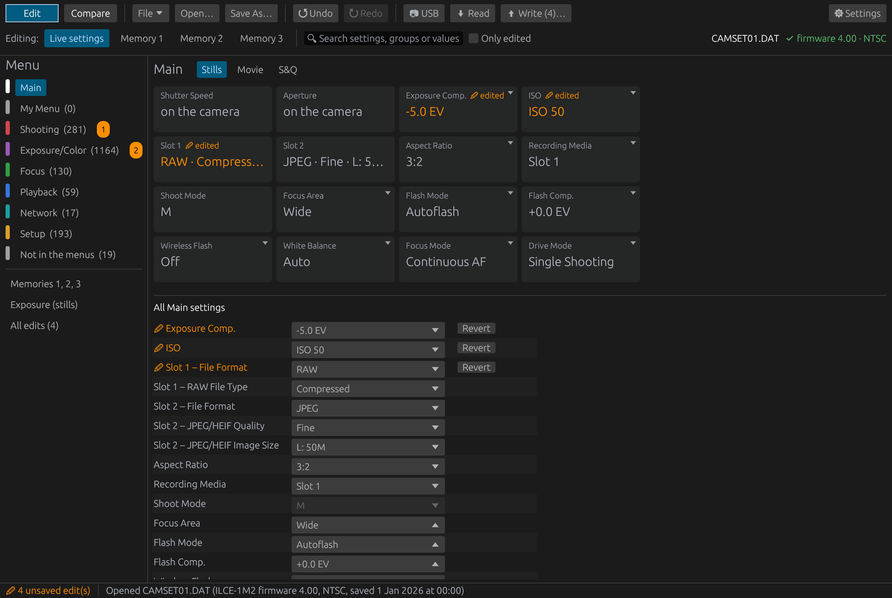
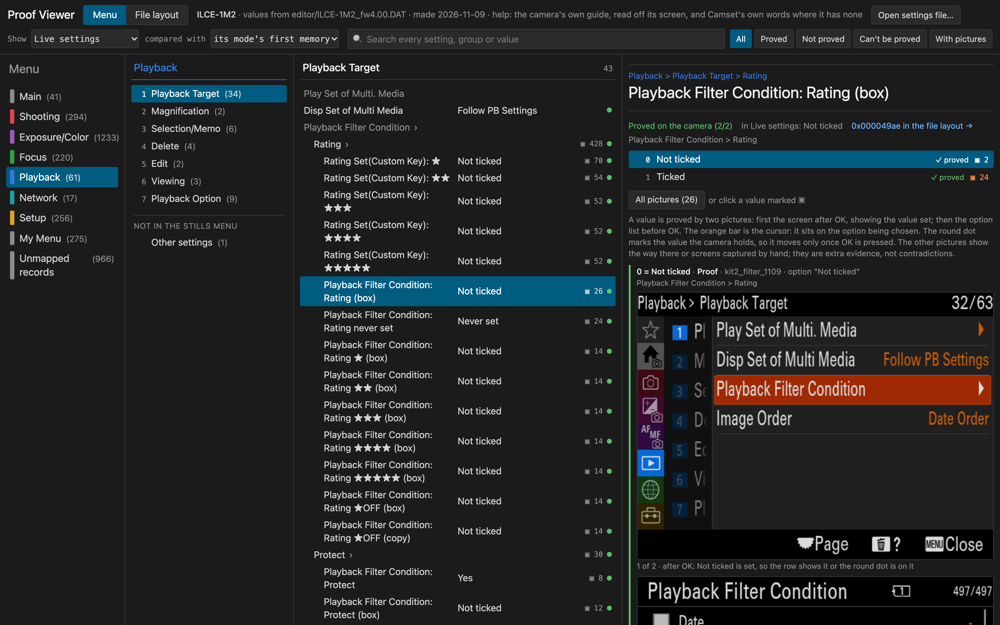

# Camset

Camset opens the settings file a Sony camera saves to its card, shows every setting in it by name, compares files and
the camera's memories, changes a value and saves a file for the camera to load back.

**Look inside your settings file now, with nothing to install:** the [definition viewer](viewer/) opens a
`CAMSET*.DAT` of any camera Camset knows and shows every setting in it by name, and the file's layout byte by byte.
The file is read in your browser and never leaves your computer.

!!! warning "At your own risk"

    --8<-- "README.md:warning"

## Is my camera supported?

| Camera | Firmware | What the editor knows |
|---|---|---|
| ILCE-1M2 (a1 II) | 4.00 | About 2,000 settings by name. [Status](STATUS.md) counts how many the camera has proved. |

Other bodies need a mapping pass first, which works out on the camera what each setting in its file means:
[map your camera](REMAPPING_PLAYBOOK.md) says how, and [which cameras the kit works with](CAMERA_SUPPORT.md) how to
check yours.

## Get it

The editor is on the [Releases page](https://github.com/camset-dev/camset/releases): a disk image for macOS on Apple
silicon, a tarball for Linux and, since 0.2.1, a zip for Windows, with an installer beside it from the release after
0.2.1. The README's [Use the editor](https://github.com/camset-dev/camset#use-the-editor) says how, which Windows
download to take, and how to open the macOS app or the Windows program the first time. Since 0.2.1 each release also
carries the definition viewer as one file,
[camset-viewer.html](https://github.com/camset-dev/camset/releases/latest/download/camset-viewer.html), to open in a
browser with no internet.

**Code signing policy:** the Windows downloads are not signed yet; the [code signing policy](CODE_SIGNING_POLICY.md)
says what will be signed, and by whom, once the project's application for free code signing is accepted.

1. **Save the settings on the camera:** MENU > Setup > Reset/Save Settings > Save/Load Settings > Save. The camera
   writes a `CAMSET*.DAT` file into the card's `PRIVATE/SONY/CAMSET` folder. Copy it to your computer and keep it:
   it is the camera's own backup.
2. **Open the file in the editor,** then compare it with another file or with the camera's memories, or change a
   value.
3. **Save and load it back:** Save As… under a new name, copy the new file into the same folder on the card, then on
   the camera Save/Load Settings > Load, and choose it.

Without a camera, Explore a sample opens a file to look around in. [Using the editor](EDITOR.md#from-the-card-and-back)
has the details and what has not been tried yet.

## How a setting is proved

The mapping kit changes each setting on the camera itself, downloads the file the camera then saves and sees which
records changed. What it proves goes into the camera's definition with its proof: which values the camera showed and
wrote, and when. The proof viewer lays out the camera's own screens beside each value. It exists only where the kit
has run, since it shows that camera's own pictures; the one below shows the a1 II's sample file. The
[definition viewer](viewer/) is the same page without the pictures, for anyone: each value with whether a proof
checked it.

To map your own camera, clone the repository, start an AI agent in it and say "read AGENTS.md and map my camera". The
README's [Map your camera](https://github.com/camset-dev/camset#map-your-camera) lists what you need,
[the playbook](REMAPPING_PLAYBOOK.md) is what the agent follows, and [the kit's design](KIT_PLAN.md) says why it works
as it does.

## For developers and contributors

- **Tutorials:** [from nothing to a first proved setting](QUICKSTART.md).
- **How-to guides:** [use the editor](EDITOR.md), [map another camera](REMAPPING_PLAYBOOK.md),
  [update your clone](UPDATING.md),
  [Windows and Linux](PORTING.md), [make a release](RELEASING.md).
- **Reference:** [status](STATUS.md), [the file format](formats/index.md) (a Kaitai Struct spec, for Kaitai's tools
  and ImHex), [memory map](MEMORY_MAP.md), [data files and their schemas](DATA_CONTRACTS.md),
  [the ILCE-1M2's page](models/ILCE-1M2_fw4.00.md) (what was measured on it and how it behaves).
- **Explanation:** [the kit's design](KIT_PLAN.md) (how a setting is proved),
  [which cameras the kit works with](CAMERA_SUPPORT.md), [where each fact lives](WHERE_FACTS_LIVE.md).
- **[Decisions](decisions/index.md)** (why things are done as they are).

The code is in the [repository](https://github.com/camset-dev/camset), and
[CONTRIBUTING](https://github.com/camset-dev/camset/blob/main/CONTRIBUTING.md) says how to send a change or a mapped
camera back.

## Version

0.2.1, released 2026-11-13; 0.1.0 is withdrawn. What changed in each release is in the
[changelog](https://github.com/camset-dev/camset/blob/main/CHANGELOG.md).
